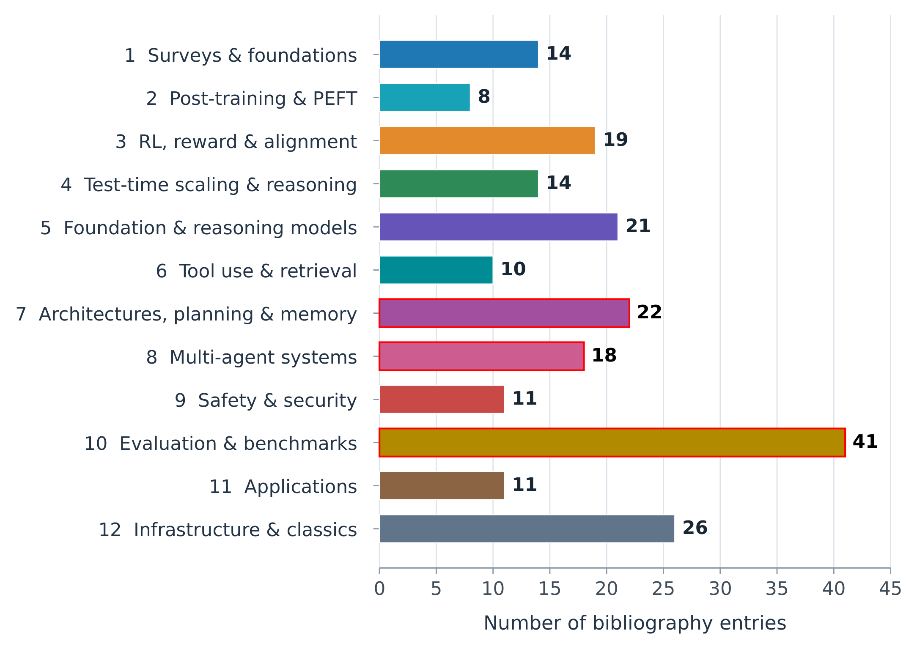
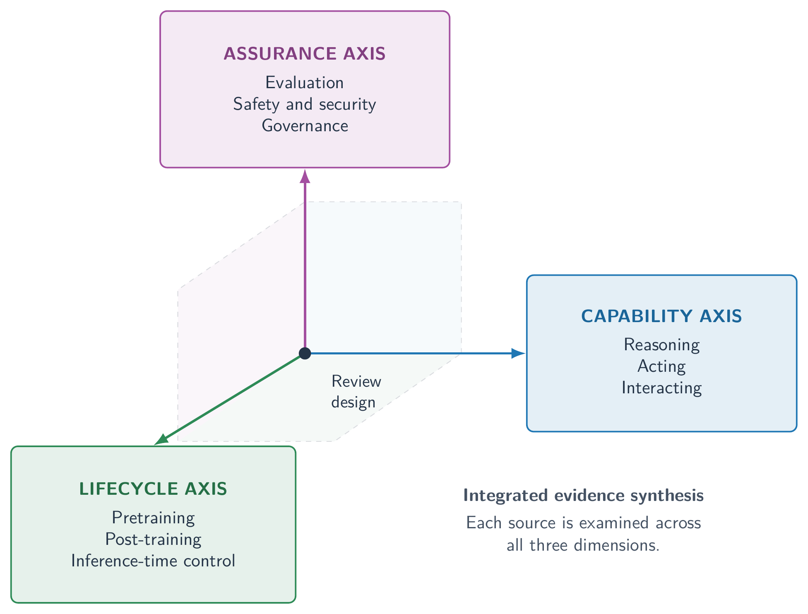
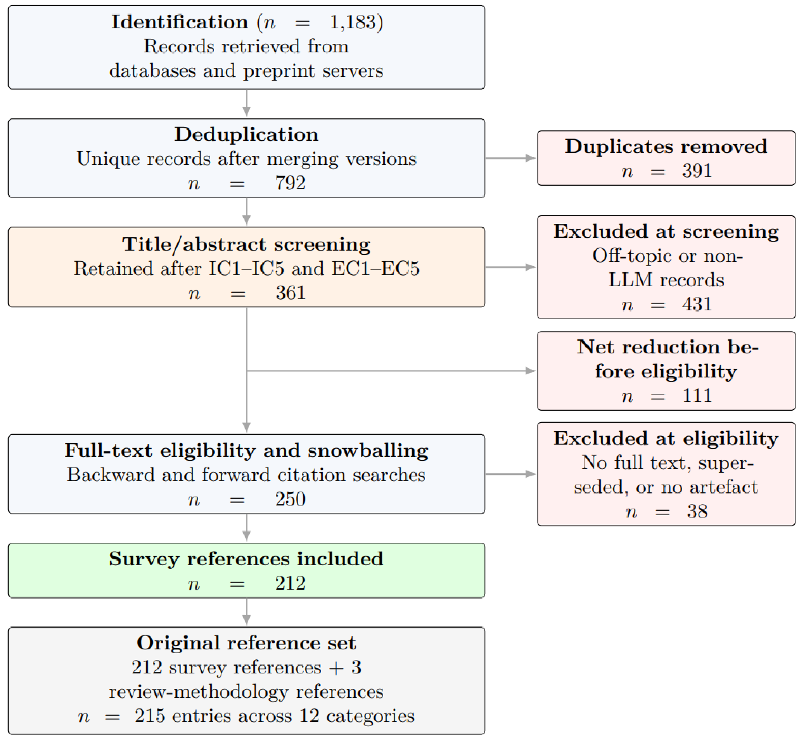
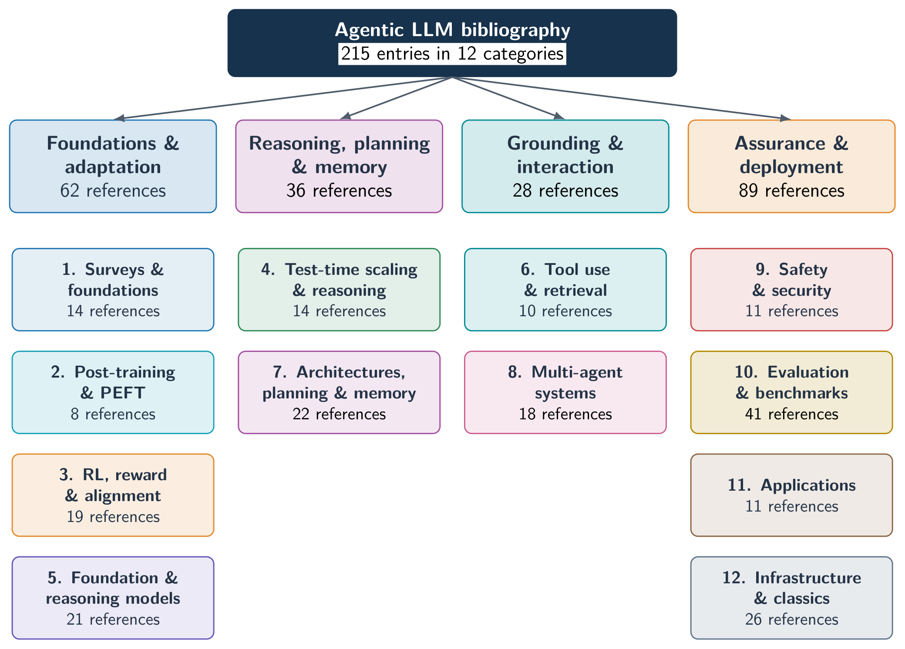

<div align="center">

# Agentic Large Language Models: Foundations, Post-Training, Architectures, Security, and Evaluation — A Comprehensive Survey

[](LICENSE)
[](#-statistics)
[](#)
[](#-contributing)

</div>

---

<p align="center">
  
</p>

*Distribution of the 215 reference entries across the twelve thematic categories. The concentration in evaluation and benchmarking, infrastructure, and architecture reflects the field's shift from capability demonstrations towards measurement, systems, and cost.*

---

Welcome to the **Agentic-LLM-Survey** repository! It publishes the survey *Agentic Large Language Models: Foundations, Post-Training, Architectures, Security, and Evaluation — A Comprehensive Survey* with reader-oriented descriptions, and classifies **every citation used in the paper** into twelve thematic categories with a direct link (arXiv, DOI, publisher, or code repository).

The full search and screening protocol is documented in **[METHODOLOGY.md](METHODOLOGY.md)**, so the index can be reproduced or audited end to end.

## 🎉 News

- **[October 2026]** Repository launched with the paper figures, reader descriptions, and the twelve-category classified bibliography.

📄 **Survey:** *Agentic Large Language Models: Foundations, Post-Training, Architectures, Security, and Evaluation — A Comprehensive Survey* (2026).

#### Author
[Hari Mohan Pandey](mailto:profharimohanpandey@gmail.com) — Department of Computing and Engineering, Bournemouth University.

Feel free to ⭐ star and fork this repository to keep up with new references and contribute to the community.

---

## 📈 Figures

Some figures from the survey paper are presented, with descriptions for readers. Figure numbers follow the paper *Agentic Large Language Models: Foundations, Post-Training, Architectures, Security, and Evaluation*.

| File | Figure | Topic |
|------|--------|-------|
| [`AgenticLLM_Review_Pipeline.png`](figures/AgenticLLM_Review_Pipeline.png) | Figure 1 | Review pipeline and paper organisation |
| [`Review_Three_Axes.png`](figures/Review_Three_Axes.png) | Figure 2 | Three-axis review-design framework |
| [`Review_screening.png`](figures/Review_screening.png) | Figure 3 | PRISMA-style screening and selection flow |
| [`Figure_02.png`](figures/Figure_02.png) | Figure 4 | Classification into four macro-themes and twelve categories |
| [`Figure_03.png`](figures/Figure_03.png) | Figure 5 | Distribution of the 215 reference entries across categories |

### Review pipeline

<p align="center">
  
</p>

**Review pipeline for the agentic LLM survey, with 16 sections grouped into eight stages.** The sequence moves from review design and foundations through training, reasoning, and system architectures to safety, applications, evaluation, and research priorities. Arrows indicate the reading order, while branches identify the main topics and their corresponding sections.

*What to look for:* the figure doubles as a map of the paper. Sections 2–4 establish the review protocol, background, and formal models; Sections 5–7 cover post-training, reasoning, and comparisons across AI approaches; Sections 8–11 cover architectures, tools, coordination, and security; the remaining sections address applications, evaluation, open problems, and future research.

### Three-axis framework

<p align="center">
  
</p>

The *capability* axis describes what agentic systems do (reasoning, acting, interacting); the *lifecycle* axis locates model adaptation and inference-time control (pretraining, post-training, inference-time control); and the *assurance* axis organises evaluation, safety and security, and governance. Each source is examined jointly across these conceptual dimensions.

*What to look for:* the three axes form the analytical grid used throughout the review and help distinguish an architectural change from changes in model adaptation or compute. The framework is paired with the eight review questions (RQ1–RQ8) in Table 5 of the paper.

### Screening and selection flow

<p align="center">
  
</p>

**Review screening and selection flow.** Identification n = 1,183 records retrieved from databases and preprint servers; deduplication n = 792 unique records after merging versions; title/abstract screening (IC1–IC5 and EC1–EC5) n = 361; full-text eligibility with backward and forward citation searches (snowballing) n = 250. Removal and exclusion counts are calculated from the reported stage totals: 391 duplicates removed (1,183 − 792), 431 screening exclusions (792 − 361), a net reduction of 111 before eligibility (361 − 250), and 38 eligibility exclusions (250 − 212). Snowballing additions and reason-specific exclusion counts are not separately reported. The final reference set contains n = 215 entries: 212 survey references and 3 review-methodology references, distributed across 12 categories (the classification is shown in Figure 4).

*What to look for:* a PRISMA-style account of how the bibliography was constructed, showing which counts are derived from the reported stage totals and which remain unavailable (snowballing additions and reason-specific exclusions) rather than being estimated. The protocol follows PRISMA reporting guidance and Snyder's semi-systematic approach (Section 2); the full protocol is documented in [METHODOLOGY.md](METHODOLOGY.md).

### Classification of the reference set

<p align="center">
  
</p>

**Classification of the 215-entry reference set (212 survey references and 3 review-methodology sources) into four macro-themes and twelve thematic categories.**

- **Foundations & adaptation** — 62 references
- **Reasoning, planning & memory** — 36 references
- **Grounding & interaction** — 28 references
- **Assurance & deployment** — 89 references

The twelve categories are: (1) Surveys & foundations, (2) Post-training & PEFT, (3) RL, reward & alignment, (4) Test-time scaling & reasoning, (5) Foundation & reasoning models, (6) Tool use & retrieval, (7) Architectures, planning & memory, (8) Multi-agent systems, (9) Safety & security, (10) Evaluation & benchmarks, (11) Applications, and (12) Infrastructure & classics. Category numbers correspond to the classified bibliography below. Cross-listed works are counted once by primary contribution.

*What to look for:* Evaluation & benchmarks is the largest category (41 entries), followed by Infrastructure & classics (26) and Architectures, planning & memory (22), with Foundation & reasoning models next (21).

### Distribution across categories

<p align="center">
  
</p>

**Distribution of the 215 reference entries across the twelve thematic categories, including the 3 review-methodology references.** 

Each entry is assigned to exactly one category by its primary contribution. Counts per category: Surveys & foundations 14; Post-training & PEFT 8; RL, reward & alignment 19; Test-time scaling & reasoning 14; Foundation & reasoning models 21; Tool use & retrieval 10; Architectures, planning & memory 22; Multi-agent systems 18; Safety & security 11; Evaluation & benchmarks 41; Applications 11; Infrastructure & classics 26.

*What to look for:* the bar chart makes the imbalance between categories immediately visible — evidence synthesis and evaluation dominate the field, while post-training-specific work (8 entries) is comparatively sparse.

---

## 📌 Contents

| Section | Subsections |
| ------- | ----------- |
| 📖 [1. Surveys, Foundations & Position Papers](#1-surveys-foundations--position-papers) | Survey, Resource, Position, Foundational |
| 🎛 [2. Post-Training, Instruction Tuning & PEFT](#2-post-training-instruction-tuning--peft) | Method, PEFT, Library |
| 🏆 [3. Reinforcement Learning, Reward Modelling & Alignment](#3-reinforcement-learning-reward-modelling--alignment) | Algorithm, Alignment, Reward Model, Benchmark |
| 🧠 [4. Test-Time Scaling, Search & Reasoning Frameworks](#4-test-time-scaling-search--reasoning-frameworks) | Prompting, Framework, Decoding, Analysis |
| 🤖 [5. Foundation & Reasoning Models (Technical Reports)](#5-foundation--reasoning-models-technical-reports) | Base model, Reasoning model |
| 🛠 [6. Tool Use, Function Calling & Retrieval](#6-tool-use-function-calling--retrieval) | Retrieval, Tool use, Orchestration, Web agent |
| 🏗 [7. Agent Architectures, Planning & Memory](#7-agent-architectures-planning--memory) | Architecture, Orchestration, Planning, Robotics |
| 🤝 [8. Multi-Agent Systems & Collaboration](#8-multi-agent-systems--collaboration) | Framework, Debate, Analysis, Test-time |
| 🛡 [9. Safety, Security & Alignment of Agents](#9-safety-security--alignment-of-agents) | Attack, Attack/Defense, Benchmark, Red-teaming |
| 📊 [10. Evaluation, Benchmarks & Datasets](#10-evaluation-benchmarks--datasets) | Knowledge, Math, Robustness, Reasoning |
| 🚀 [11. Applications & Domain Deployments](#11-applications--domain-deployments) | Healthcare, Science, Causal inference, Finance |
| ⚙ [12. Infrastructure, Efficiency & Classical Foundations](#12-infrastructure-efficiency--classical-foundations) | Architecture, Prompting, MoE, Distributed |
| 📈 [Figures](#-figures) | Review pipeline, Three-axis framework, Screening flow, Classification, Distribution |

> **Link conventions.** `arXiv` links point to the abstract page on [arxiv.org](https://arxiv.org); DOI links resolve through [doi.org](https://doi.org); `Code` links point to the official repository; entries without a stable public identifier (books, standards, some workshop papers) carry only a venue badge. Titles correspond one-to-one to the entries in the survey's `refs.tex`.

---

## 1. Surveys, Foundations & Position Papers

***Link to the survey: §1 (Introduction) and §2 (Background and Preliminaries).*** This group collects the prior surveys, position papers, and textbooks that define the field's vocabulary and its open debates. The survey leans on these works to position itself—taking the reasoning–acting–interacting taxonomy from Plaat et al. and Xi et al., the construction–application–evaluation framing from Wang et al., and the post-training deep dive from Kumar et al.—and to justify its critical premise that benchmark capability is not the same as dependability. The classical texts (Russell and Norvig; Wooldridge) supply the agent vocabulary that is reused throughout the formalisation, so this category is both the map of the field and the source of the paper's framing.

- A Survey on Large Language Model Based Autonomous Agents [[Paper]](https://doi.org/10.1007/s11704-024-40231-1) 
- The Rise and Potential of Large Language Model Based Agents: A Survey [[Paper]](https://arxiv.org/abs/2309.07864) 
- Agentic Large Language Models, a Survey [[Paper]](https://arxiv.org/abs/2503.23037) 
- LLM Post-Training: A Deep Dive into Reasoning Large Language Models [[Paper]](https://arxiv.org/abs/2502.21321) 
- Awesome-LLM-Post-training: Curated Resources for LLM Post-Training [[Code]](https://github.com/mbzuai-oryx/Awesome-LLM-Post-training) 
- A Comprehensive Survey on Benchmarks and Solutions in Software Engineering of LLM-Empowered Agentic Systems [[Paper]](https://arxiv.org/abs/2510.09721) 
- Responsible Agentic Reasoning and AI Agents: A Critical Survey [[Paper]](https://doi.org/10.3390/robotics14100180) -2025-blue)
- A Survey of Large Language Models [[Paper]](https://arxiv.org/abs/2303.18223) 
- Large Language Models: A Survey [[Paper]](https://arxiv.org/abs/2402.06196) 
- Large Language Models and Agentic AI: How Modern AI Systems Are Evolving into Autonomous Agents 
- Multi-Agent Collaboration Mechanisms: A Survey of LLMs [[Paper]](https://arxiv.org/abs/2501.06322) 
- Extensive Survey on Multi-Agent LLM Systems 
- Intelligent Agents -1999-blue)
- Artificial Intelligence: A Modern Approach 

---

## 2. Post-Training, Instruction Tuning & PEFT

***Link to the survey: §4 (Post-Training and Adaptation for Agentic LLMs), with background in §2.*** These references carry the survey's central thesis that agentic behaviour is manufactured *after* pretraining rather than inherited from scale alone. The category spans supervised instruction tuning and the parameter-efficient methods—LoRA, QLoRA, prefix tuning, adapters—that make adaptation affordable, together with the libraries (PEFT, TRL) that practitioners actually use. The survey uses them to argue that one base model can behave as a cautious assistant, an aggressive tool user, or a careful step-by-step reasoner depending on the post-training recipe, which is why this chapter is treated as decisive rather than optional.

- Training Language Models to Follow Instructions with Human Feedback [[Paper]](https://arxiv.org/abs/2203.02155) 
- Tulu 3: Pushing Frontiers in Open Language Model Post-Training [[Paper]](https://arxiv.org/abs/2411.15124) 
- LoRA: Low-Rank Adaptation of Large Language Models [[Paper]](https://arxiv.org/abs/2106.09685) 
- QLoRA: Efficient Finetuning of Quantized LLMs [[Paper]](https://arxiv.org/abs/2305.14314) 
- PEFT: State-of-the-Art Parameter-Efficient Fine-Tuning [[Code]](https://github.com/huggingface/peft) 
- Prefix-Tuning: Optimizing Continuous Prompts for Generation [[Paper]](https://arxiv.org/abs/2101.00190) 
- Parameter-Efficient Transfer Learning for NLP [[Paper]](https://arxiv.org/abs/1902.00751) 
- TRL: Transformer Reinforcement Learning [[Code]](https://github.com/huggingface/trl) 

---

## 3. Reinforcement Learning, Reward Modelling & Alignment

***Link to the survey: §4 (Post-Training and Adaptation) and §10 (Safety, Security, and Alignment of Agentic Systems).*** This is the policy-optimisation and preference-modelling core: RLHF and its PPO/TRPO ancestry, direct preference methods such as DPO and ORPO, RLAIF, and outcome- versus process-based reward modelling. The survey treats these methods as the engine that shapes tone, refusal behaviour, and reasoning, and it uses them to draw its central distinction between aligning *what a model says* and constraining *what an agent does* once tools are involved. The reward- and process-model references additionally feed the verification and test-time discussion elsewhere in the paper.

- Proximal Policy Optimization Algorithms [[Paper]](https://arxiv.org/abs/1707.06347) 
- Trust Region Policy Optimization [[Paper]](https://arxiv.org/abs/1502.05477) 
- Simple Statistical Gradient-Following Algorithms for Connectionist RL [[Paper]](https://doi.org/10.1007/BF00992696) 
- Asynchronous Methods for Deep Reinforcement Learning [[Paper]](https://arxiv.org/abs/1602.01783) 
- Deep Reinforcement Learning from Human Preferences [[Paper]](https://arxiv.org/abs/1706.03741) 
- Learning to Summarize from Human Feedback [[Paper]](https://arxiv.org/abs/2009.01325) 
- Training a Helpful and Harmless Assistant with RLHF [[Paper]](https://arxiv.org/abs/2204.05862) 
- Constitutional AI: Harmlessness from AI Feedback [[Paper]](https://arxiv.org/abs/2212.08073) 
- RLAIF: Scaling Reinforcement Learning from Human Feedback with AI Feedback [[Paper]](https://arxiv.org/abs/2309.00267) 
- Direct Preference Optimization: Your Language Model Is Secretly a Reward Model [[Paper]](https://arxiv.org/abs/2305.18290) 
- ORPO: Monolithic Preference Optimization without Reference Model [[Paper]](https://arxiv.org/abs/2403.07691) 
- Let's Verify Step by Step [[Paper]](https://arxiv.org/abs/2305.20050) 
- PRMBench: A Fine-Grained and Challenging Benchmark for Process-Level Reward Models [[Paper]](https://arxiv.org/abs/2501.03124) 
- DeepSeekMath: Pushing the Limits of Mathematical Reasoning in Open Language Models [[Paper]](https://arxiv.org/abs/2402.03300) 
- DeepSeek-R1: Incentivizing Reasoning Capability in LLMs via Reinforcement Learning [[Paper]](https://arxiv.org/abs/2501.12948) 
- Satori: Reinforcement Learning with Chain-of-Action-Thought Enhances LLM Reasoning [[Paper]](https://arxiv.org/abs/2502.02508) 

---

## 4. Test-Time Scaling, Search & Reasoning Frameworks

***Link to the survey: §5 (Reasoning Frameworks and Planning Formalisms) and the test-time-scaling part of §4.*** These works define the reasoning scaffolds—chain-of-thought, ReAct, tree-of-thought, graph-of-thought, self-consistency, self-refine, reflexion—and the compute-scaling policies that spend inference budget for accuracy (best-of-N, search, verification). The survey compares them structurally—by cost, faithfulness, and error behaviour—rather than by their headline scores, and it stresses that most reported "reasoning gains" move several levers at once: the prompt, the post-training objective, and the search procedure. The faithfulness reference (Turpin et al.) anchors the warning that a reasoning trace may not reflect the model's actual computation.

- Chain-of-Thought Prompting Elicits Reasoning in Large Language Models [[Paper]](https://arxiv.org/abs/2201.11903) 
- ReAct: Synergizing Reasoning and Acting in Language Models [[Paper]](https://arxiv.org/abs/2210.03629) 
- Tree of Thoughts: Deliberate Problem Solving with Large Language Models [[Paper]](https://arxiv.org/abs/2305.10601) 
- Graph of Thoughts: Solving Elaborate Problems with Large Language Models [[Paper]](https://arxiv.org/abs/2308.09687) 
- Self-Consistency Improves Chain of Thought Reasoning in Language Models [[Paper]](https://arxiv.org/abs/2203.11171) 
- Self-Refine: Iterative Refinement with Self-Feedback [[Paper]](https://arxiv.org/abs/2303.17651) 
- Reflexion: Language Agents with Verbal Reinforcement Learning [[Paper]](https://arxiv.org/abs/2303.11366) 
- Large Language Models Are Zero-Shot Reasoners [[Paper]](https://arxiv.org/abs/2205.11916) 
- Progressive-Hint Prompting Improves Reasoning in Large Language Models [[Paper]](https://arxiv.org/abs/2302.09729) 
- Language Models Don't Always Say What They Think: Unfaithful Explanations in CoT [[Paper]](https://arxiv.org/abs/2305.04388) 
- Scaling LLM Test-Time Compute Optimally Can Be More Effective Than Scaling Parameters [[Paper]](https://arxiv.org/abs/2408.03314) 
- Can 1B LLM Surpass 405B LLM? Rethinking Compute-Optimal Test-Time Scaling [[Paper]](https://arxiv.org/abs/2502.06703) 
- Search-o1: Agentic Search-Enhanced Large Reasoning Models [[Paper]](https://arxiv.org/abs/2501.05366) 
- rStar-Math: Small LLMs Can Master Math Reasoning with Self-Evolved Deep Thinking [[Paper]](https://arxiv.org/abs/2501.04519) 

---

## 5. Foundation & Reasoning Models (Technical Reports)

***Link to the survey: §4 (Post-Training and Adaptation) and §5 (Reasoning), as concrete anchors.*** The technical reports for GPT, Llama, Qwen, Gemma, Mistral, Phi, Gemini, Claude, DeepSeek, and Kimi, together with the o1, Marco-o1, and DeepScaleR reasoning models, let the survey tie abstract claims about post-training and reasoning to named systems and their documented recipes. They are the reference points against which the survey's taxonomy is illustrated and its comparisons are grounded; without them, claims about "post-training" and "reasoning models" would float free of actual systems.

- Language Models Are Few-Shot Learners (GPT-3) [[Paper]](https://arxiv.org/abs/2005.14165) 
- GPT-4 Technical Report [[Paper]](https://arxiv.org/abs/2303.08774) 
- Llama 2: Open Foundation and Fine-Tuned Chat Models [[Paper]](https://arxiv.org/abs/2307.09288) 
- The Llama 3 Herd of Models [[Paper]](https://arxiv.org/abs/2407.21783) 
- Qwen2 Technical Report [[Paper]](https://arxiv.org/abs/2407.10671) 
- Gemma: Open Models Based on Gemini Research and Technology [[Paper]](https://arxiv.org/abs/2403.08295) 
- Mistral 7B [[Paper]](https://arxiv.org/abs/2310.06825) 
- Phi-3 Technical Report [[Paper]](https://arxiv.org/abs/2404.14219) 
- Gemini: A Family of Highly Capable Multimodal Models [[Paper]](https://arxiv.org/abs/2312.11805) 
- The Claude 3 Model Family: Opus, Sonnet, Haiku [[Paper]](https://www.anthropic.com/news/claude-3-family) 
- DeepSeek-V3 Technical Report [[Paper]](https://arxiv.org/abs/2412.19437) 
- OpenAI o1 System Card [[Paper]](https://arxiv.org/abs/2412.16720) 
- Kimi k1.5: Scaling Reinforcement Learning with LLMs [[Paper]](https://arxiv.org/abs/2501.12599) 
- Marco-o1: Towards Open Reasoning Models for Open-Ended Solutions [[Paper]](https://arxiv.org/abs/2411.14405) 
- DeepScaleR: Surpassing O1-Preview with a 1.5B Model by Scaling RL [[Paper]](https://pretty-radio-b75.notion.site/DeepScaleR-Surpassing-O1-Preview-with-a-1-5B-Model-by-Scaling-RL-19681902c1468005bed8ca303013a4e2) 

---

## 6. Tool Use, Function Calling & Retrieval

***Link to the survey: §8 (Tool Use, Function Calling, and External Grounding).*** These references trace the progression from passive retrieval (RAG) through active tool calling (Toolformer, ToolLLM, Gorilla, HuggingGPT) to grounded action with real side effects. The survey uses them to explain how tool use *shifts* rather than removes the reliability problem—moving it from answer correctness to tool selection, argument construction, and permission boundaries—and to motivate its treatment of dependency, security, and verification risk at the point where untrusted context meets executable action.

- Retrieval-Augmented Generation for Knowledge-Intensive NLP Tasks [[Paper]](https://arxiv.org/abs/2005.11401) 
- Toolformer: Language Models Can Teach Themselves to Use Tools [[Paper]](https://arxiv.org/abs/2302.04761) 
- ToolLLM: Facilitating LLMs to Master 16000+ Real-World APIs [[Paper]](https://arxiv.org/abs/2307.16789) 
- Gorilla: Large Language Model Connected with Massive APIs [[Paper]](https://arxiv.org/abs/2305.15334) 
- HuggingGPT: Solving AI Tasks with ChatGPT and Its Friends [[Paper]](https://arxiv.org/abs/2303.17580) 
- WebGPT: Browser-Assisted Question-Answering with Human Feedback [[Paper]](https://arxiv.org/abs/2112.09332) 
- An Iterative Self-Correcting Agentic RAG System 
- From Retrieval to Cognitive Orchestration: Standardizing Context Management in Agentic AI 

---

## 7. Agent Architectures, Planning & Memory

***Link to the survey: §7 (Agent Architectures and Design Paradigms) and the memory/planning formalisation in §3 (Mathematical Foundations).*** This group supports the survey's layered account of agents—reactive, deliberative, goal-based, and utility-based—and its hierarchical memory model that runs from the raw event stream through L1 active context to L4 semantic memory. The embodied, web, and simulation references (Voyager, Mind2Web, Generative Agents, and the robotics works) show how these architectures behave in practice and where they fail, so the category connects the theory of agent design to the systems that instantiate it.

- The Auton Agentic AI Framework [[Paper]](https://arxiv.org/abs/2602.23720) 
- From Prompt-Response to Goal-Directed Systems: The Evolution of Agentic AI Software Architecture [[Paper]](https://arxiv.org/abs/2602.10479) 
- HALO: Hierarchical Autonomous Logic-Oriented Orchestration for Multi-Agent LLM Systems [[Paper]](https://arxiv.org/abs/2505.13516) 
- Hierarchical Agentic AI Framework for Autonomous Task Planning 
- Pre-Act: Multi-Step Planning and Reasoning Improves Acting in LLM Agents [[Paper]](https://arxiv.org/abs/2505.09970) 
- Hierarchical Prompting with Dual LLM Modules for Robotic Task and Motion Planning 
- Think, Act, Learn: A Framework for Autonomous Robotic Agents Using Closed-Loop LLMs [[Paper]](https://arxiv.org/abs/2507.19854) 
- Model-Based Reinforcement Learning: A Survey [[Paper]](https://arxiv.org/abs/2006.16712) 
- The Architecture of Cognition 
- Why There Are Complementary Learning Systems in the Hippocampus and Neocortex [[Paper]](https://doi.org/10.1037/0033-295X.102.3.419) 
- Ghost in the Minecraft: Generally Capable Agents for Open-World Environments [[Paper]](https://arxiv.org/abs/2305.17144) 
- Describe, Explain, Plan and Select: Interactive Planning with LLMs [[Paper]](https://arxiv.org/abs/2302.01560) 
- Do As I Can, Not As I Say: Grounding Language in Robotic Affordances [[Paper]](https://arxiv.org/abs/2204.01691) 
- Inner Monologue: Embodied Reasoning through Planning with Language Models [[Paper]](https://arxiv.org/abs/2207.05608) 
- RT-2: Vision-Language-Action Models Transfer Web Knowledge to Robotic Control [[Paper]](https://arxiv.org/abs/2307.15818) 
- Voyager: An Open-Ended Embodied Agent with Large Language Models [[Paper]](https://arxiv.org/abs/2305.16291) 
- Mind2Web: Towards a Generalist Agent for the Web [[Paper]](https://arxiv.org/abs/2306.06070) 
- WebShop: Towards Scalable Real-World Web Interaction with Grounded Language Agents [[Paper]](https://arxiv.org/abs/2207.01206) 
- Generative Agents: Interactive Simulacra of Human Behavior [[Paper]](https://arxiv.org/abs/2304.03442) 
- Generative Agent Simulations of 1,000 People [[Paper]](https://arxiv.org/abs/2411.10109) 
- Parameter-Efficient Action Planning with Large Language Models for Vision-and-Language Navigation [[Paper]](https://doi.org/10.1016/j.patcog.2025.112462) 

---

## 8. Multi-Agent Systems & Collaboration

***Link to the survey: §9 (Multi-Agent Systems and Collaborative Intelligence) and the consensus result in §3.*** The frameworks and debate methods collected here (AutoGen, MetaGPT, ChatDev, CAMEL, AgentVerse, multi-agent debate) are the evidence base for the survey's cost-adjusted question—when does a team of agents actually beat a single strong agent under the same budget—and for its catalogue of failure modes: correlated error, confabulated consensus, coordination deadlock, communication contamination, and accountability diffusion. The category therefore supports both the survey's formal account of majority-vote aggregation and its practical guidance to specialise deliberately, verify rather than vote, and bound coordination.

- AutoGen: Enabling Next-Gen LLM Applications via Multi-Agent Conversation [[Paper]](https://arxiv.org/abs/2308.08155) 
- MetaGPT: Meta Programming for a Multi-Agent Collaborative Framework [[Paper]](https://arxiv.org/abs/2308.00352) 
- ChatDev: Communicative Agents for Software Development [[Paper]](https://arxiv.org/abs/2307.07924) 
- CAMEL: Communicative Agents for "Mind" Exploration of LLM Society [[Paper]](https://arxiv.org/abs/2303.17760) 
- AgentVerse: Facilitating Multi-Agent Collaboration and Exploring Emergent Behaviors [[Paper]](https://arxiv.org/abs/2308.10848) 
- Improving Factuality and Reasoning in Language Models through Multiagent Debate [[Paper]](https://arxiv.org/abs/2305.14325) 
- Encouraging Divergent Thinking in LLMs through Multi-Agent Debate [[Paper]](https://arxiv.org/abs/2305.19118) 
- Is Multi-Agent Debate (MAD) the Silver Bullet? An Empirical Analysis [[Paper]](https://arxiv.org/abs/2503.12029) 
- Two Heads Are Better Than One: Test-Time Scaling of Multi-Agent Collaborative Reasoning [[Paper]](https://arxiv.org/abs/2504.09772) 
- AgentNet: Decentralized Evolutionary Coordination for LLM-Based Multi-Agent Systems [[Paper]](https://arxiv.org/abs/2504.00587) 
- SiriuS: Self-Improving Multi-Agent Systems via Bootstrapped Reasoning [[Paper]](https://arxiv.org/abs/2502.04780) 
- ReSo: A Reward-Driven Self-Organizing LLM-Based Multi-Agent System for Reasoning 
- AgentSims: An Open-Source Sandbox for Large Language Model Evaluation [[Paper]](https://arxiv.org/abs/2308.04026) 
- RecAgent: A Novel Simulation Paradigm for Recommender Systems [[Paper]](https://arxiv.org/abs/2306.02552) 
- S3: Social-Network Simulation System with LLM-Empowered Agents [[Paper]](https://arxiv.org/abs/2307.14984) 
- Advancing Agentic AI through Communication Protocols 
- Beyond a Single Perspective: A Multi-Agent Debate Framework for Affective Computing [[Paper]](https://doi.org/10.1016/j.patcog.2026.113445) 

---

## 9. Safety, Security & Alignment of Agents

***Link to the survey: §10 (Safety, Security, and Alignment of Agentic Systems) and the safe-policy-projection formalism in §3.*** These works cover the whole execution loop: input-level jailbreaks, indirect prompt injection through retrieved content, tool and memory poisoning, multi-agent propagation, and supply-chain compromise, together with benchmark-driven harm measurement (AgentHarm, InjecAgent), red-teaming, and defensive architectures. The survey draws on them to argue that safety must be enforced at the boundary between untrusted context and executable action, and that it is an architectural property rather than a filter bolted on at the end.

- Not What You've Signed Up For: Compromising Real-World LLM-Integrated Applications with Indirect Prompt Injection [[Paper]](https://arxiv.org/abs/2302.12173) 
- Prompt Injection Attacks and Defenses in LLM-Integrated Applications [[Paper]](https://arxiv.org/abs/2310.12815) 
- InjecAgent: Benchmarking Indirect Prompt Injections in Tool-Integrated LLM Agents [[Paper]](https://arxiv.org/abs/2403.02691) 
- AgentHarm: A Benchmark for Measuring Harmfulness of LLM Agents [[Paper]](https://arxiv.org/abs/2410.09024) 
- Rainbow Teaming: Open-Ended Generation of Diverse Adversarial Prompts [[Paper]](https://arxiv.org/abs/2402.16822) 
- ToolSafe: Enhancing Tool Invocation Safety of LLM-Based Agents [[Paper]](https://arxiv.org/abs/2601.10156) 
- Multi-Agent Security Tax: Trading Off Security and Collaboration Capabilities 
- G-Safeguard: A Topology-Guided Security Lens and Treatment on LLM-Based Multi-Agent Systems 
- Toward Securing AI Agents Like Operating Systems 
- Architecting Resilient LLM Agents: A Guide to Secure Plan-Then-Execute Implementations [[Paper]](https://arxiv.org/abs/2509.08646) 

---

## 10. Evaluation, Benchmarks & Datasets

***Link to the survey: §12 (Evaluation, Benchmarking, and Reproducibility), revisited in §13 (Discussion).*** This category provides the capability, reasoning, agentic, and safety benchmarks that the survey analyses, and it is the basis for its construct-validity critique: a single score conflates the base model, the post-training procedure, the tool set, the retrieval corpus, and the inference-time compute budget. The benchmark references also support the survey's recommended reporting controls and its call to move from static accuracy toward process-level, traceable, and adversarial evaluation.

- Measuring Massive Multitask Language Understanding (MMLU) [[Paper]](https://arxiv.org/abs/2009.03300) 
- Training Verifiers to Solve Math Word Problems (GSM8K) [[Paper]](https://arxiv.org/abs/2110.14168) 
- Measuring Mathematical Problem Solving with the MATH Dataset [[Paper]](https://arxiv.org/abs/2103.03874) 
- MATH-Perturb: Benchmarking LLMs' Math Reasoning against Hard Perturbations [[Paper]](https://arxiv.org/abs/2502.06453) 
- FrontierMath: A Benchmark for Evaluating Advanced Mathematical Reasoning [[Paper]](https://arxiv.org/abs/2411.04872) 
- Challenging BIG-Bench Tasks and Whether Chain-of-Thought Can Solve Them (BBH) [[Paper]](https://arxiv.org/abs/2210.09261) 
- GPQA: A Graduate-Level Google-Proof Q&A Benchmark [[Paper]](https://arxiv.org/abs/2311.12022) 
- SuperGPQA: Scaling LLM Evaluation across 285 Graduate Disciplines [[Paper]](https://arxiv.org/abs/2502.14739) 
- Humanity's Last Exam [[Paper]](https://arxiv.org/abs/2501.14249) 
- Beyond the Imitation Game: Quantifying and Extrapolating the Capabilities of LMs (BIG-Bench) [[Paper]](https://arxiv.org/abs/2206.04615) 
- BIG-Bench Extra Hard (BBEH) [[Paper]](https://arxiv.org/abs/2502.19187) 
- LongReason: A Synthetic Long-Context Reasoning Benchmark via Context Expansion [[Paper]](https://arxiv.org/abs/2501.15089) 
- LR2Bench: Evaluating Long-Chain Reflective Reasoning via Constraint Satisfaction [[Paper]](https://arxiv.org/abs/2502.17848) 
- Evaluating Large Language Models Trained on Code (HumanEval) [[Paper]](https://arxiv.org/abs/2107.03374) 
- SWE-bench: Can Language Models Resolve Real-World GitHub Issues? [[Paper]](https://arxiv.org/abs/2310.06770) 
- Training a Helpful and Harmless Assistant (HH-RLHF) [[Paper]](https://arxiv.org/abs/2204.05862) 
- RewardBench: Evaluating Reward Models for Language Modeling [[Paper]](https://arxiv.org/abs/2403.13787) 
- Multimodal RewardBench: Holistic Evaluation of Reward Models for VLMs [[Paper]](https://arxiv.org/abs/2502.14191) 
- TruthfulQA: Measuring How Models Mimic Human Falsehoods [[Paper]](https://arxiv.org/abs/2109.07958) 
- HellaSwag: Can a Machine Really Finish Your Sentence? [[Paper]](https://arxiv.org/abs/1905.07830) 
- Judging LLM-as-a-Judge with MT-Bench and Chatbot Arena [[Paper]](https://arxiv.org/abs/2306.05685) 
- AlpacaEval: An Automatic Evaluator of Instruction-Following Models [[Code]](https://github.com/tatsu-lab/alpaca_eval) 
- FActScore: Fine-Grained Atomic Evaluation of Factual Precision [[Paper]](https://arxiv.org/abs/2305.14251) 
- ToolLLM / ToolBench [[Paper]](https://arxiv.org/abs/2307.16789) 
- API-Bank: A Comprehensive Benchmark for Tool-Augmented LLMs [[Paper]](https://arxiv.org/abs/2304.08244) 
- ToolComp: A Multi-Tool Reasoning and Process Supervision Benchmark [[Paper]](https://arxiv.org/abs/2501.01290) 
- WebArena: A Realistic Web Environment for Building Autonomous Agents [[Paper]](https://arxiv.org/abs/2307.13854) 
- OSWorld: Benchmarking Multimodal Agents for Open-Ended Tasks in Real Computer Environments [[Paper]](https://arxiv.org/abs/2404.07972) 
- GAIA: A Benchmark for General AI Assistants [[Paper]](https://arxiv.org/abs/2311.12983) 
- τ-bench: A Benchmark for Tool-Agent-User Interaction in Real-World Domains [[Paper]](https://arxiv.org/abs/2406.12045) 
- AgentBench: Evaluating LLMs as Agents [[Paper]](https://arxiv.org/abs/2308.03688) 
- MCPEval: Automatic MCP-Based Deep Evaluation for AI Agent Models 
- MMMU: A Massive Multi-Discipline Multimodal Understanding and Reasoning Benchmark [[Paper]](https://arxiv.org/abs/2311.16502) 
- LlamaV-o1: Rethinking Step-by-Step Visual Reasoning in LLMs [[Paper]](https://arxiv.org/abs/2501.06186) 
- ATCMD-Bench: Agentic Traditional Chinese Medicine Diagnosis Benchmark for Large Language Models via Multi-Agent Simulation [[Paper]](https://doi.org/10.1016/j.patcog.2026.113679) 

---

## 11. Applications & Domain Deployments

***Link to the survey: §11 (Applications and Domain Deployments).*** The domain works span software engineering, healthcare, scientific discovery, finance, robotics, and remote sensing. They illustrate how reasoning, planning, tools, memory, and verification combine in practice, and they supply the domain-specific risk arguments that bound acceptable autonomy—most sharply the knowledge–practice gap in clinical settings, where models that excel on knowledge benchmarks degrade on realistic tasks. The category is what keeps the survey honest about deployment, since it shows where capability and safety practice diverge.

- EHRAgent: Code Empowers LLMs for Few-Shot Complex Tabular Reasoning on EHRs [[Paper]](https://arxiv.org/abs/2406.00027) 
- MedAgentBench v2: Improving Medical LLM Agent Design [[Paper]](https://arxiv.org/abs/2501.12377) 
- Knowledge-Practice Performance Gap in Clinical Large Language Models [[Paper]](https://doi.org/10.2196/68047) 
- The AI Scientist: Towards Fully Automated Open-Ended Scientific Discovery [[Paper]](https://arxiv.org/abs/2408.06292) 
- Towards an AI Co-Scientist [[Paper]](https://arxiv.org/abs/2502.18864) 
- Toward Ultra-Long-Horizon Agentic Science: Cognitive Accumulation for ML Engineering [[Paper]](https://arxiv.org/abs/2601.10402) 
- ML-Tool-Bench: Tool-Augmented Planning for ML Tasks [[Paper]](https://arxiv.org/abs/2512.00672) 
- End-to-End Causal Inference with LLM Agents via a Structured Framework 
- AI Agents in Financial Markets: Architecture, Applications, and Systemic Implications [[Paper]](https://doi.org/10.3390/fintech5020016) -2026-blue)
- ThinkGeo: Evaluating Tool-Augmented Agents for Remote Sensing Tasks [[Paper]](https://arxiv.org/abs/2505.23752) 

---

## 12. Infrastructure, Efficiency & Classical Foundations

***Link to the survey: §3 (Mathematical Foundations and Formal Frameworks), §6 (Critical Comparison Across AI Paradigms), and the cost discussion in §13.*** The infrastructure references—vLLM, FlashAttention, GPTQ, LLM.int8, ZeRO, Megatron—underpin the survey's token-economics and efficiency analysis, which treats agentic cost as a system-level rather than model-level quantity, while the classical works trace the paradigm lineage from symbolic AI and the perceptron through CNNs, LSTMs, and transformers, and supply the reinforcement-learning, causality, and interpretability background. This category gives the survey its historical depth and its quantitative footing on cost.

- Attention Is All You Need [[Paper]](https://arxiv.org/abs/1706.03762) 
- Large Language Models Are Zero-Shot Reasoners [[Paper]](https://arxiv.org/abs/2205.11916) 
- Switch Transformers: Scaling to Trillion Parameter Models with Simple and Efficient Sparsity [[Paper]](https://arxiv.org/abs/2101.03961) 
- Megatron-LM: Training Multi-Billion Parameter Language Models Using Model Parallelism [[Paper]](https://arxiv.org/abs/1909.08053) 
- ZeRO: Memory Optimizations Toward Training Trillion Parameter Models [[Paper]](https://arxiv.org/abs/1910.02054) 
- Efficient Memory Management for Large Language Model Serving with PagedAttention (vLLM) [[Paper]](https://arxiv.org/abs/2309.06180) 
- FlashAttention: Fast and Memory-Efficient Exact Attention with IO-Awareness [[Paper]](https://arxiv.org/abs/2205.14135) 
- GPTQ: Accurate Post-Training Quantization for Generative Pre-Trained Transformers [[Paper]](https://arxiv.org/abs/2210.17323) 
- LLM.int8(): 8-Bit Matrix Multiplication for Transformers at Scale [[Paper]](https://arxiv.org/abs/2208.07339) 
- Carbon Emissions and Large Neural Network Training [[Paper]](https://arxiv.org/abs/2104.10350) 
- Scheduling: Theory, Algorithms, and Systems 
- The Perceptron: A Probabilistic Model for Information Storage and Organization [[Paper]](https://doi.org/10.1037/h0042519) 
- Learning Representations by Back-Propagating Errors [[Paper]](https://doi.org/10.1038/323533a0) 
- Gradient-Based Learning Applied to Document Recognition [[Paper]](https://doi.org/10.1109/5.726791) 
- Long Short-Term Memory [[Paper]](https://doi.org/10.1162/neco.1997.9.8.1735) 
- Deep Learning [[Paper]](https://doi.org/10.1038/nature14539) 
- ImageNet Classification with Deep Convolutional Neural Networks [[Paper]](https://proceedings.neurips.cc/paper/2012/hash/c399862d3b9d6b76c8436e924a68c45b-Abstract.html) 
- Learning Transferable Visual Models from Natural Language Supervision (CLIP) [[Paper]](https://arxiv.org/abs/2103.00020) 
- "Why Should I Trust You?": Explaining the Predictions of Any Classifier (LIME) [[Paper]](https://arxiv.org/abs/1602.04938) 
- Machine Learning 
- Random Forests [[Paper]](https://doi.org/10.1023/A:1010933404324) 
- Reinforcement Learning: An Introduction 
- Handbook of Knowledge Representation 
- The Logic Theory Machine [[Paper]](https://doi.org/10.1109/TIT.1956.1056815) 
- The Book of Why 

---


---

## 🤝 Contributing

Corrections to links, venue metadata, or categorisation are welcome. Please open an issue or submit a pull request. When proposing a change, keep the entries sorted as they appear in `refs.tex` and, where possible, repopulate the index with the generator in [`scripts/build_readme.py`](scripts/build_readme.py).

---

## 📝 Citation

If you find this resource useful, please cite the survey:

```bibtex
@article{pandey2026agenticllm,
  title   = {Agentic Large Language Models: Foundations, Post-Training,
             Architectures, Security, and Evaluation --- A Comprehensive Survey},
  author  = {Pandey, Hari Mohan},
  journal = {xxx},
  year    = {2026}
}
```

---

## 📄 License

Released under the [MIT License](LICENSE). Venue names, titles, and author lists belong to their respective publishers; links point to the canonical public records.

---

## ⭐ Star History

[](https://star-history.com/#profharimohanpandey/Agentic-LLM-Survey&Date)

---

Looking forward to your feedback, contributions, and stars! ⭐
Please raise any issues or questions [here](https://github.com/profharimohanpandey/Agentic-LLM-Survey/issues).
